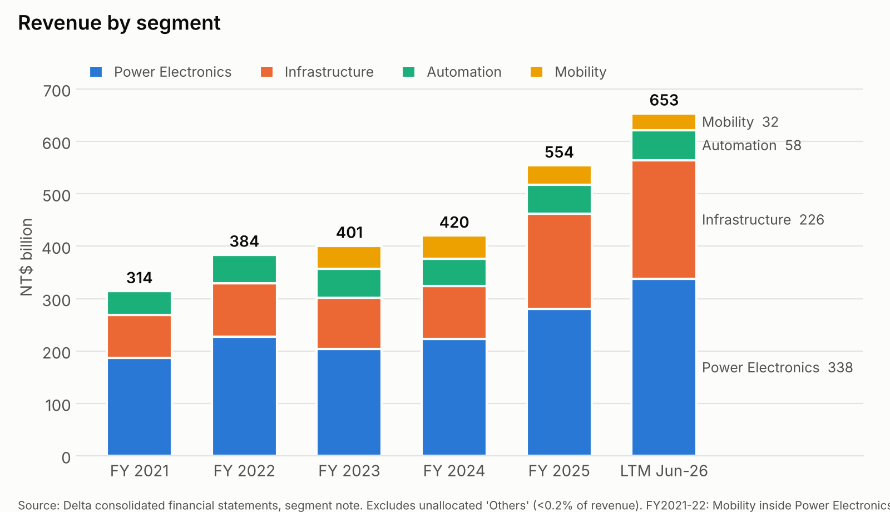
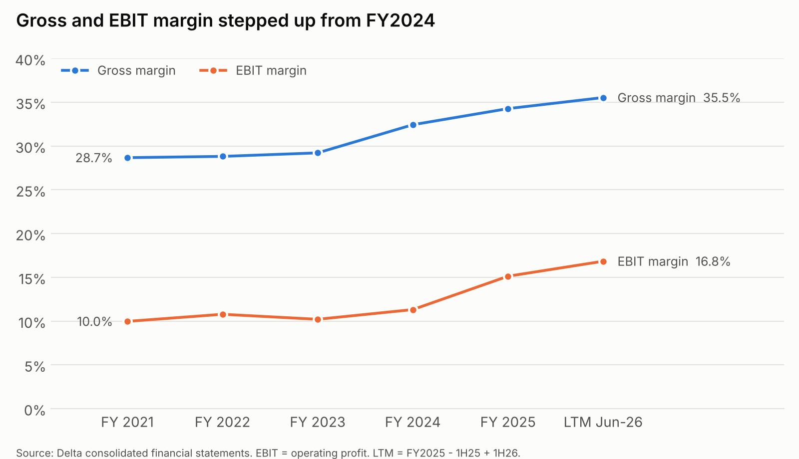
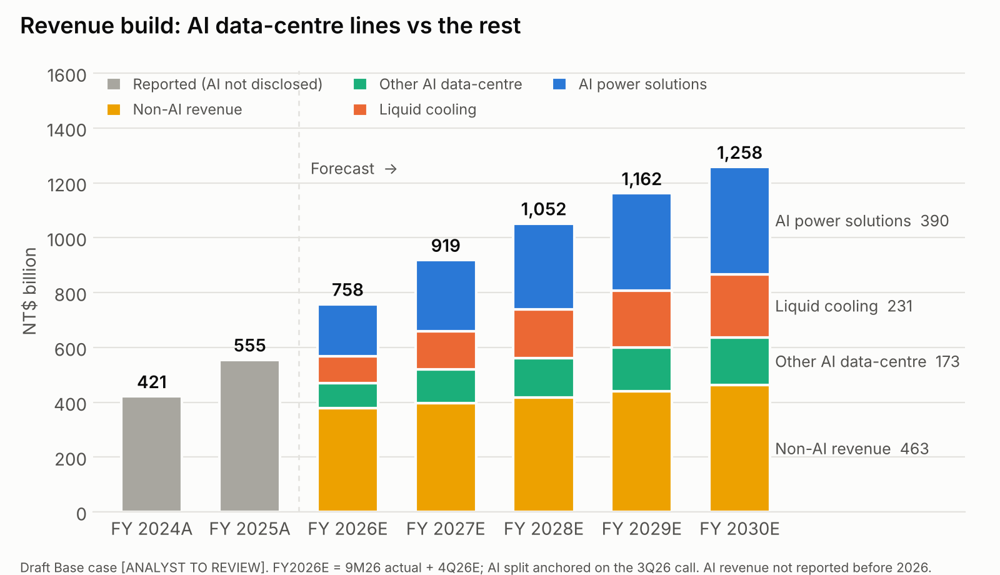
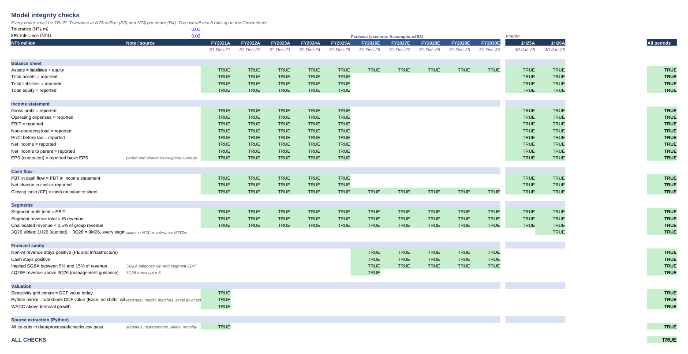
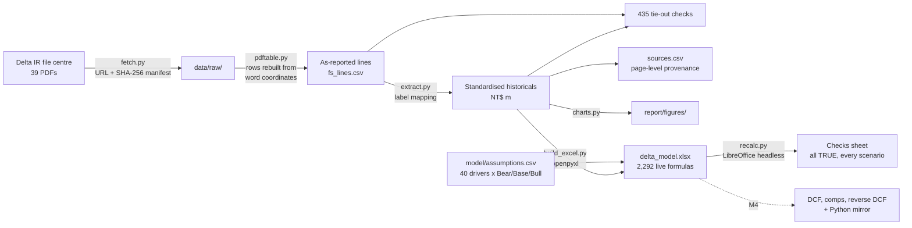

# Delta Electronics (2308.TW): The AI power play

**An equity research initiation on Delta Electronics, the Taiwan-listed maker of power and thermal-management products, built from primary filings: a reproducible data pipeline, a linked three-statement model, valuation and a 10–12 page report.**

[](https://github.com/anou-shka/delta-volts/actions/workflows/ci.yml)


By **Anoushka**: CS + Business (NTU), CFA Level II candidate.

> *Student research for educational purposes only. Not investment advice.*

---

## Why this project

Delta Electronics sells the power supplies, power distribution and liquid cooling that go inside AI server racks. Its revenue grew **32% in FY2025** and **37% in the first nine months of 2026**, and management says AI data-centre businesses are now about **half of revenue**. The question this initiation answers is: **how much of Delta is now an AI bet, and what is the market already paying for?**

The research is built to be audited:
- **Every number is traced to a page.** Historicals are extracted by code from Delta's audited and reviewed filings. Each figure is logged in [`data/sources.csv`](data/sources.csv) with document, page, URL and access date (1,005 entries).
- **Every extraction is proven, not assumed.** 435 automated tie-out checks cover subtotals, links between the three statements, cash, quarterly sums, segment totals against EBIT, monthly releases against quarters, the Q3 earnings slides against the audited first half, and prior-year restatements. All pass, and CI reruns them on every push.
- **The model is live, not pasted.** [`model/delta_model.xlsx`](model/delta_model.xlsx) is generated by code with 2,292 working formulas: five years of history and a five-year forecast in Bear, Base and Bull scenarios. The statements recompute every subtotal, the forecast balance sheet balances in every year and scenario, and every integrity check must be TRUE. CI rebuilds and recalculates it on every push.
- **The analyst's judgement is visible.** Modelling decisions are recorded with their reasoning in [`docs/decisions.md`](docs/decisions.md). Judgement calls in the report are marked `[ANALYST TO REVIEW]` until signed off.

## What the filings show so far

<picture>
  <source media="(prefers-color-scheme: dark)" srcset="report/figures/segment_revenue_dark.png">
  
</picture>

<picture>
  <source media="(prefers-color-scheme: dark)" srcset="report/figures/margins_dark.png">
  
</picture>

| NT$ bn unless stated | FY2021 | FY2022 | FY2023 | FY2024 | FY2025 | 1H26 | 9M26 |
|---|---:|---:|---:|---:|---:|---:|---:|
| Revenue | 314.7 | 384.4 | 401.2 | 421.1 | 554.9 | 342.6 | 539.7 |
| Gross margin | 28.7% | 28.8% | 29.2% | 32.4% | 34.3% | 36.3% | 35.5% |
| EBIT margin | 10.0% | 10.8% | 10.2% | 11.3% | 15.1% | 17.2% | 17.0% |
| EPS, basic (NT$) | 10.32 | 12.58 | 12.86 | 13.56 | 23.14 | 17.59 | 26.64 |
| Cash from operations | 28.3 | 46.5 | 71.1 | 72.9 | 98.5 | 63.1 | – |
| Capex (PPE + intangibles) | 24.3 | 22.4 | 28.3 | 35.1 | 47.2 | 27.8 | – |

*9M26 from the 3Q26 earnings slides (29 Oct 2026); Delta had not yet posted the English Q3 statements, so 9M26 cash-flow figures are not available ([decision D6](docs/decisions.md)).*

**Key findings so far:**
1. **Growth is concentrated in Infrastructure.** Infrastructure revenue rose **82% to NT$182.0bn in FY2025** and its segment profit went from NT$5.5bn to NT$28.4bn. This is the segment that holds data-centre power and liquid-cooling systems. Mobility (EV powertrain) shrank 16% and made a loss.
2. **AI is now about half of revenue, on management's own numbers.** On the 3Q26 call (29 Oct 2026):
   - AI data-centre businesses are **about 50% of revenue**;
   - of that, AI power solutions are **about 25%** (correcting the earlier reading of ">25% AI-related products");
   - liquid cooling was **NT$25bn in 3Q26, about 13% of revenue** (up from ~10% in FY2025).

   These figures, not press estimates, anchor the model's AI line ([decisions D1 and D7](docs/decisions.md)).
3. **Margins have stepped up with the mix.** Gross margin rose from 28.7% (FY2021) to 36.3% (1H26). **1H26 EPS of NT$17.59 is up 89% y/y** and already above every full year before FY2025. Management calls ~35% gross margin "reasonable", so further expansion isn't assumed.
4. **The next test is capital intensity.** Management expects **~NT$70bn of capex in FY2026**, up from NT$47.2bn in FY2025, with new plants in Thailand, the US, China and Taiwan. From April 2026, new AI equipment is depreciated over **3 years**. The model must show whether returns hold as D&A catches up.
5. **Q3 showed the strain of growth.** Revenue rose 31% y/y to a record NT$197.1bn, but gross margin fell to 34.1%: inventory write-downs worth about 1.7% of revenue, from component shortages and shifting delivery schedules. Infrastructure growth slowed to 25% y/y in Q3, against 47% for the nine months. October revenue was another record (NT$74.7bn, +30% y/y), and management guided Q4 above Q3.
6. **The balance sheet is a net cash position.** At 30 Jun 2026: cash NT$182.4bn against borrowings and bonds of NT$70.6bn.
7. **Returns jumped and working capital is stable.** Return on equity rose from 16% (FY2024) to **24% (FY2025)**. Receivable and inventory days have held at roughly 80 and 100, while payable days rose to 95. The two weak segments are clear in the schedules: Automation's margin fell from 10.8% (FY2021) to 1.0% (FY2025) and turned negative in 1H26, and Mobility is loss-making.

## Forecasts (draft — awaiting the analyst's Base case)

<picture>
  <source media="(prefers-color-scheme: dark)" srcset="report/figures/revenue_build_dark.png">
  
</picture>

How the forecast is built ([decisions D6–D10](docs/decisions.md)):
- **FY2026E** = 9M26 actual + a 4Q26 estimate (management guided Q4 above Q3).
- **AI data-centre revenue** is anchored at 50% of FY2026E revenue (power 25%, liquid cooling 13%, other 12%). It then grows at **AI data-centre capex growth × Delta's content/share gain**, the two links that public data can support.
- **The rest of the business** grows with its own drivers: industrial cycle for Automation, EV demand for Mobility.
- **EBIT** = Σ segment revenue × segment margin. **The balance sheet** rolls forward from FY2025A with working-capital days and capex/depreciation schedules, and cash balances it.

| Draft outputs | Bear | Base | Bull |
|---|---:|---:|---:|
| FY2026E revenue (NT$bn) | 739.7 | 757.7 | 767.7 |
| FY2026E EPS (NT$) | 32.24 | 36.72 | 39.33 |
| FY2030E revenue (NT$bn) | 778.8 | 1,257.6 | 1,758.0 |
| FY2030E AI data-centre share of revenue | 52% | 63% | 70% |
| FY2030E EBIT margin | 14.2% | 17.9% | 19.7% |
| FY2030E EPS (NT$) | 29.68 | 62.63 | 98.10 |

Every forecast driver (40 of them × 3 scenarios) lives in [`model/assumptions.csv`](model/assumptions.csv) with a one-line rationale. Draft values are tagged `[ANALYST TO REVIEW]` until the analyst signs off the Base case.

**Rating, price target and reverse DCF:** M4–M5, once the Base case is set.

## Status

| Milestone | Deliverable | Status |
|---|---|---|
| **M1 Data** | Filings pipeline, historicals FY2021–1H26, sources, tie-out checks | ✅ Done |
| **M2 Historical model** | Excel: Cover, Assumptions, Historicals, Segments, IS/BS/CF, Schedules, Checks (all TRUE) | ✅ Done |
| **M3 Forecasts** | Segment and AI revenue build, Bear/Base/Bull, 5-year three-statement forecast (balances in every scenario) | 🟡 Built; Base case under analyst review |
| M4 Valuation | WACC, DCF, comps, sensitivities, football field, reverse DCF, Python mirror + test | ⏳ Next |
| M5 Report | 10–12 page initiation with charts | ⏳ |
| M6 Polish | PDF, case study, interview defence sheet | ⏳ |

## The model

[`model/delta_model.xlsx`](model/delta_model.xlsx) follows banking conventions: blue for inputs, black for formulas, green for links between sheets. Units are NT$ million throughout, with a unit note on every sheet.

| Sheet | What it does |
|---|---|
| **Cover** | Company, period, scenario, key financials FY2024A–FY2028E, and one cell that is TRUE only if every check passes |
| **Assumptions** | Scenario selector (Bear / Base / Bull). Every forecast driver by year, with the three scenario inputs, a live row the model uses, the historical value for reference, and a rationale |
| **Historicals** | The only hard-coded financial data: extracted as-reported figures, FY2021A–FY2025A plus 1H25A and 1H26A |
| **Segments** | Segment revenue and profit (history, 3Q26/9M26 from the slides, forecast), the AI data-centre build, non-AI revenue, growth, mix, margins and the management disclosures behind the AI anchors |
| **IS / BS / CF** | The three statements, FY2021A–FY2030E, formulas only. Historical "other" lines tie to separately reported subtotals; in the forecast, cash balances the balance sheet, so *assets = liabilities + equity* tests the model |
| **Schedules** | Working-capital days, capex, PP&E and intangibles roll-forwards, cost of debt, tax, dividends and payout, returns |
| **Checks** | Integrity checks for every historical and forecast period: balance sheet balances, subtotals equal reported figures, cash ties, segments equal EBIT and revenue, the Q3 slides tie to the audited first half, plus forecast sanity checks (positive cash, non-AI revenue, SG&A range, Q4 guidance) |

<p align="center"></p>

<p align="center"></p>

## How it works



- **Extraction.** Delta's PDFs don't keep text in reading order: a value can print one line below its label, and the brackets on negative numbers are separate glyphs. [`pdftable.py`](src/delta/pdftable.py) therefore rebuilds each row from word positions. Labels sit left of the notes column, and figures are assigned to columns by their right edge.
- **Standardisation.** Reported lines map to model lines with explicit patterns ([`extract.py`](src/delta/extract.py)). Residual lines are computed against reported totals, so the standardised balance sheet ties by construction.
- **Restatements.** Each year comes from its own audited report, and the next year's comparatives are checked against it (no statement restatements were found). Segments use the latest restated basis: Delta carved Mobility out of Power Electronics in 2024 and reclassified products again in 2025.
- **Definitions.** EBITDA = EBIT + D&A (Delta's slides add non-operating income). Capex is cash paid for PPE and intangibles. 2Q cash flows = 1H − 1Q.

## Run it

```bash
pip install -r requirements.txt
make all      # fetch filings (skips ones already in data/raw/) -> extract -> Excel model -> charts
make test     # tie-outs; workbook recalculates with zero errors; every check TRUE in Bear, Base and Bull
```

The raw PDFs are committed, so the pipeline runs offline from a fresh clone. `make fetch` re-downloads them from Delta's IR site. Building the model needs LibreOffice (`soffice`) to recalculate the formulas; the tests also check that the statement sheets contain no hard-coded numbers.

## Repository map

```
SPEC.md                    project brief and working rules
data/
  raw/                     original filings, untouched (+ manifest.csv)
  processed/               historicals, segments, monthly revenue, checks
  sources.csv              every sourced figure with page and URL
  sources_manual.csv       figures from transcripts and slides
  slides_3q26.csv          3Q26 / 9M26 figures from the earnings slides
src/delta/
  fetch.py                 download filings with provenance
  pdftable.py              position-based statement parser
  extract.py               standardise, check, write sources
  charts.py                figures (light + dark)
  build_excel.py           writes the Excel model with live formulas
  recalc.py                recalculates it in LibreOffice and scans for errors
  preview.py               renders model sheets to PNG
model/assumptions.csv      every forecast driver: Bear / Base / Bull x FY2026E-FY2030E, with rationale
model/delta_model.xlsx     the model
report/figures/            charts and model previews
docs/
  decisions.md             analyst decision log
  milestone-notes.md       per-milestone summary, modelling choices, interview questions
  m1-review-sample.md      10 figures for manual verification
tests/                     extraction and Excel model tests
```

## Sources

Primary sources only, all from [Delta's investor relations site](https://www.deltaww.com/en-US/investors):
- consolidated financial statements FY2021–FY2025 (audited), Q1 and Q2 2026 (reviewed);
- annual reports 2024–2025;
- analyst meeting slides 4Q21–3Q26 and the 2Q26 and 3Q26 meeting transcripts;
- monthly revenue releases, Jan 2025 – Oct 2026.

Market data (yfinance), peer filings and Damodaran datasets come in M4. Full detail is in [`data/README.md`](data/README.md).

## Limitations

- **Delta doesn't report AI revenue as a line item.** The AI split rests on management's rounded statements ("about 50%", "about 25%", "about 13%"), and how the AI lines split between Power Electronics and Infrastructure is an analyst assumption. The AI line is an estimate with a range.
- **FY2021–FY2022 segment data is on the old 3-segment basis**, so Mobility history begins in FY2023.
- **Q3 2026 comes from the earnings slides** until the English Q3 statements are published. The slides tie to the audited first half to within NT$1m per segment, but the 30 Sep 2026 balance sheet and 9M cash flow aren't available yet, so the forecast balance sheet rolls forward from FY2025A.
- **The forecast is a draft** until the analyst sets the Base case; every draft driver is tagged `[ANALYST TO REVIEW]`.
- **The transcripts are English translations.** Delta notes the Mandarin original prevails.
- **Public information only.** No non-public or company-internal information is used.

---

*Student research for educational purposes only. Not investment advice. Figures in NT$ (TWD) unless stated; Delta reports in NT$ thousands under Taiwan IFRS.*
