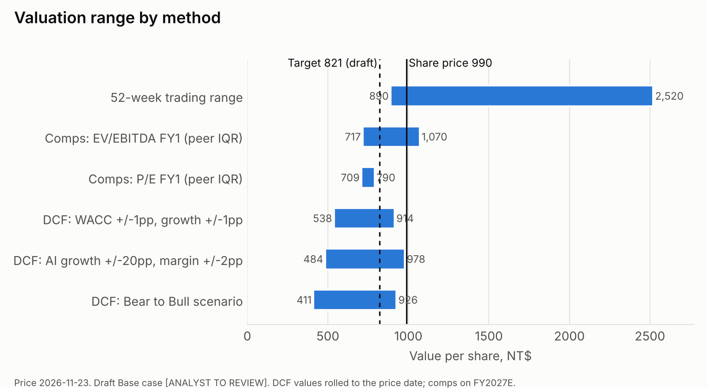
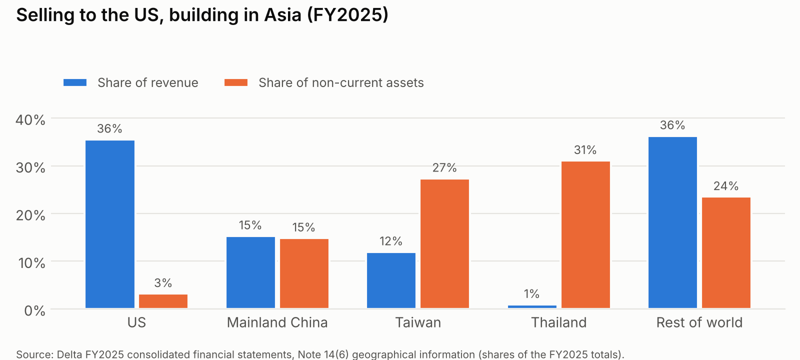
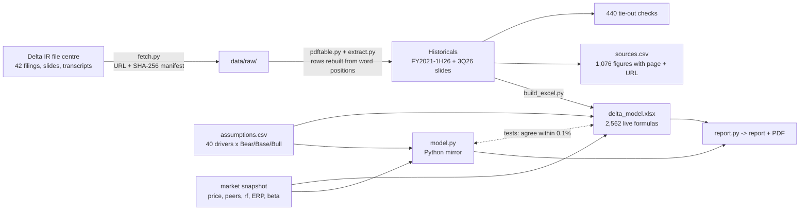
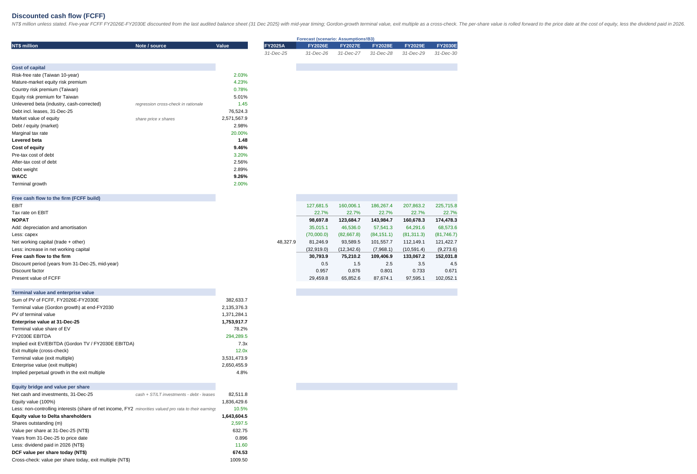
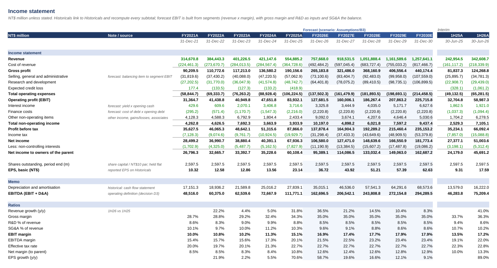

# Delta Electronics (2308.TW): The AI power play

**An equity research initiation on Delta Electronics, the Taiwan-listed maker of the power supplies, power distribution and liquid cooling that go inside AI server racks. Built entirely from primary filings, with a code-generated Excel model, a Python mirror that proves it, and a 10-page report.**

[](https://github.com/anou-shka/delta-volts/actions/workflows/ci.yml)


By **Anoushka**: CS + Business (NTU), CFA Level II candidate.

📄 **[Read the report (PDF)](report/delta_initiation.pdf)** · 📊 **[Excel model](model/delta_model.xlsx)** · 🧭 [Decision log](docs/decisions.md) · 🗂 [Case study](docs/case-study.md) · 🎤 [Interview defence sheet](docs/defence.md)

> *Student research for educational purposes only. Not investment advice.*

---

## At a glance

| Rating `[ANALYST TO REVIEW]` | 12-month target | Price (23 Nov 2026) | Upside | DCF value | Comps value |
|---|---|---|---|---|---|
| **Sell** (draft) | **NT$821** | NT$990 | **−17%** | NT$675 | NT$859 |

**The question:** how much of Delta is now an AI bet, and what is the market still paying for?

**The answer, on the draft Base case:**
- **About half of Delta is AI data-centre business**, by management's own figures.
- **Even after the stock more than halved** (NT$2,050 on 6 Oct to NT$990 on 23 Nov, in an AI-led sell-off across Taiwan), the price still implies **AI data-centre capex growing about 48% a year in 2027–30, against 14% in the Base case**. The alternative reading is that the market is paying for growth well beyond 2030: a 12× exit multiple alone justifies NT$990.

That gap is the investment debate. The rating and the Base case are the analyst's call, and each is tagged `[ANALYST TO REVIEW]` until signed off.

<picture>
  <source media="(prefers-color-scheme: dark)" srcset="report/figures/football_field_dark.png">
  
</picture>

## Key findings

1. **The AI exposure is real and audited.**
   - **Revenue:** NT$554.9bn in FY2025 (+32%) and NT$539.7bn in 9M26 (+37%).
   - **Infrastructure segment profit:** up from NT$5.5bn to NT$28.4bn in one year.
   - **Group operating margin:** 10.0% (FY2021) to 17.0% (9M26).
   - **AI share, per the 3Q26 call:** AI data-centre businesses are about **50% of revenue**; AI power solutions about 25%; liquid cooling NT$25bn in the quarter (about 13%).
2. **Q3 showed the strain of growth.** Gross margin fell to 34.1% on inventory write-downs (about 1.7% of revenue), and Infrastructure growth slowed to 25% y/y. October was still a record month (NT$74.7bn, +30% y/y).
3. **Capital intensity is stepping up.** Capex goes from NT$47.2bn (FY2025) to about NT$70bn (2026), and new AI equipment is now depreciated over three years.
4. **Tariff risk is structural.** The US is 36% of revenue (23% in FY2021) but holds only 3% of Delta's long-term assets; production sits in Thailand, Taiwan and China.
5. **The valuation turns on one judgement.**
   - **Gordon growth at 2%,** capped by the NT$ risk-free rate, gives NT$675 a share.
   - **A peer-style 12× exit multiple** gives NT$1,010.
   - **Consensus is above the draft Base case:** FY2027 EPS NT$60.4 vs NT$43.9.

<picture>
  <source media="(prefers-color-scheme: dark)" srcset="report/figures/revenue_build_dark.png">
  
</picture>

<picture>
  <source media="(prefers-color-scheme: dark)" srcset="report/figures/geography_dark.png">
  
</picture>

## Deliverables

| # | Deliverable | Where | What makes it credible |
|---|---|---|---|
| 1 | Linked 3-statement model, segment-driven, with DCF, comps and scenarios | [`model/delta_model.xlsx`](model/delta_model.xlsx) | Generated by code: 13 sheets, 2,562 live formulas, zero errors. All integrity checks are TRUE in Bear, Base and Bull, and the statement sheets contain no typed-in numbers |
| 2 | Python mirror of the model | [`src/delta/model.py`](src/delta/model.py) | Agrees with the recalculated workbook within 0.1% for every forecast year and scenario; also solves the reverse DCF |
| 3 | Initiation report, 10 pages | [`report/delta_initiation.pdf`](report/delta_initiation.pdf) ([Markdown](report/delta_initiation.md)) | Generated from the model, so the text can't disagree with the spreadsheet; 18 cited sources |
| 4 | Charts: revenue mix, margins, AI exposure, geography, football field, sensitivity heatmap | [`report/figures/`](report/figures/) | Light and dark versions; colour-blind-safe palette |
| 5 | README and case study | this page; [`docs/case-study.md`](docs/case-study.md) | |
| 6 | Interview defence sheet | [`docs/defence.md`](docs/defence.md) | 33 questions in 6 groups, with the evidence for each |

## Method



How the work is kept honest:
- **Every number is traced to a page.** Historicals are extracted by code from Delta's audited and reviewed filings. Rows are rebuilt from word positions, because the PDFs don't keep text in reading order. Each figure is logged with document, page, URL and access date in [`data/sources.csv`](data/sources.csv).
- **Every extraction is proven.** 440 tie-outs check subtotals, links between the three statements, cash, quarters against half-years, segments against EBIT, monthly revenue against quarters, the Q3 slides against the audited first half, geography against group revenue, and prior-year restatements.
- **The forecast is explicit.**
  - FY2026E = 9M26 actual + a 4Q26 estimate.
  - AI data-centre revenue is anchored on management's disclosures, then grows with **AI capex growth × Delta's content/share gain**. Those are the two links public data can support; Delta discloses neither rack units nor content per rack.
  - EBIT = segment revenue × segment margin. In the forecast balance sheet, cash is the balancing item from the cash flow statement, so *assets = liabilities + equity* tests the model.
- **The valuation is NT$-consistent.**
  - **WACC 9.26%:** Taiwan 10-year 2.03% (TPEx), mature ERP 4.23% + Taiwan CRP 0.78% (Damodaran), bottom-up beta 1.48 (regression 1.73 shown alongside).
  - **DCF:** five years of FCFF from the last audited balance sheet, rolled forward to the price date.
  - **Minorities** are valued pro rata to their earnings, not at book.
  - **Comps:** forward EV/EBITDA and P/E for Vertiv, Schneider, Eaton, Lite-On and AcBel.
- **Judgement is written down.** [`docs/decisions.md`](docs/decisions.md) records 18 dated decisions, each with its reasoning and its effect on the model. [`docs/milestone-notes.md`](docs/milestone-notes.md) explains each stage, with interview questions.

## The model

[`model/delta_model.xlsx`](model/delta_model.xlsx) follows banking conventions: blue inputs, black formulas, green links between sheets, yellow Base-case inputs. Units are NT$ million.

| Sheet | What it does |
|---|---|
| **Cover** | Price, DCF and comps values, target, rating, the spec's key financials table (incl. P/E, EV/EBITDA, dividend yield) and one cell that is TRUE only if every check passes |
| **Assumptions** | Scenario selector; every driver by year with Bear / Base / Bull inputs, the live row, the historical reference and a rationale; valuation inputs; sensitivity shifts |
| **Historicals** | The only hard-coded financial data: as-reported figures FY2021A–FY2025A, 1H25A, 1H26A |
| **Segments** | Segment revenue and profit (history, 3Q26/9M26, forecast), the AI data-centre build and the disclosures behind it |
| **IS / BS / CF** | The three statements, FY2021A–FY2030E, formulas only |
| **Schedules** | Working capital, capex, PP&E and intangibles, debt, tax, dividends, returns |
| **DCF / Comps** | WACC, FCFF, Gordon and exit-multiple terminal values, equity bridge, target and rating; peer table and implied value |
| **Sensitivity / Football field** | WACC × growth (live), AI growth × margin, reverse DCF; valuation ranges by method |
| **Checks** | Balance sheet, subtotals, cash, segments, slides vs audited, forecast sanity, Python mirror agreement |

<details>
<summary>Model previews</summary>

<p align="center"></p>
<p align="center"></p>
<p align="center"></p>
</details>

## Run it

Prerequisites: Python 3.11+, LibreOffice (`soffice`, recalculates the workbook) and pandoc (report PDF).

```bash
pip install -r requirements.txt
make all      # filings (already in data/raw/) -> extract -> mirror + Excel -> charts -> report -> PDF
make test     # 26 tests: tie-outs, zero formula errors, every check TRUE in every scenario,
              # Excel = Python within 0.1%, report in sync with the model, PDF renders
make market   # refresh the market snapshot (moves the valuation date)
```

The filings and the market snapshot are committed, so `make all` runs offline from a fresh clone and reproduces every number. To change the view, edit [`model/assumptions.csv`](model/assumptions.csv) or [`model/valuation_inputs.csv`](model/valuation_inputs.csv) and run `make all`: the workbook, valuation, charts, report and PDF all update.

## What's left for the analyst

- **Set the Base case.** Accept or change the drafts in `model/assumptions.csv`. The AI capex path and segment margins matter most.
- **Choose the terminal-value approach** (decision D14): Gordon at 2% gives NT$675; a 12× exit gives NT$1,010.
- **Write the thesis, key debate and rating** in the report (drafts with reasoning are in `src/delta/report.py`).
- **Swap the 3Q26 slide figures for the English Q3 statements** once Delta publishes them (decision D6).

## Limitations

- **Delta doesn't report AI revenue as a line item.** The AI anchors are management's rounded statements, and the split of AI revenue between Power Electronics and Infrastructure is an assumption.
- **Q3 2026 comes from the earnings slides** (they tie to the audited first half within NT$1m per segment). The forecast balance sheet therefore rolls forward from FY2025A.
- **Segment history before FY2023 is on Delta's old 3-segment basis**, so Mobility history starts in FY2023.
- **Peer forward EBITDA is estimated** (TTM EBITDA × consensus revenue growth). Consensus figures are Yahoo Finance analyst averages.
- **The price is a dated snapshot** in a volatile market, and the transcripts are English translations (Mandarin prevails).
- **Public information only.** No non-public or company-internal information is used.

## Sources

Primary sources from [Delta's investor relations site](https://www.deltaww.com/en-US/investors):
- consolidated financial statements FY2021–FY2025 (audited) and Q1–Q2 2026 (reviewed);
- annual reports;
- results slides 4Q21–3Q26 and the 2Q26 and 3Q26 transcripts;
- monthly revenue releases to October 2026.

Market data: Yahoo Finance via yfinance (snapshot 23 Nov 2026). Risk-free rate: TPEx. ERP, country risk and betas: Damodaran (Jan 2026). Industry facts: NVIDIA and the IEA. Detail is in [`data/README.md`](data/README.md).

<details>
<summary>Repository map</summary>

```
SPEC.md                       project brief and working rules
data/raw/                     filings (+ manifest.csv), market/ snapshot, damodaran/ datasets
data/processed/               historicals, segments, geography, monthly revenue, checks
data/sources.csv              every sourced figure with page and URL
data/sources_manual.csv       figures from transcripts, slides and market sources
data/slides_3q26.csv          3Q26 / 9M26 figures from the earnings slides
src/delta/
  fetch.py  pdftable.py  extract.py   filings -> checked historicals and sources
  market.py                           market snapshot
  build_excel.py  recalc.py           Excel model with live formulas, recalculated by LibreOffice
  model.py                            Python mirror, reverse DCF, sensitivities
  charts.py  preview.py               figures and model previews
  report.py  pdf.py                   report from the model; A4 PDF
model/                        assumptions.csv, valuation_inputs.csv, valuation_summary.json, delta_model.xlsx
report/                       delta_initiation.md / .pdf, figures/
docs/                         decisions, milestone notes, case study, defence sheet, review sample
tests/                        extraction, Excel, mirror, report and PDF tests
```
</details>

---

*Student research for educational purposes only. Not investment advice. Figures in NT$ (TWD) unless stated; Delta reports in NT$ thousands under Taiwan IFRS.*
