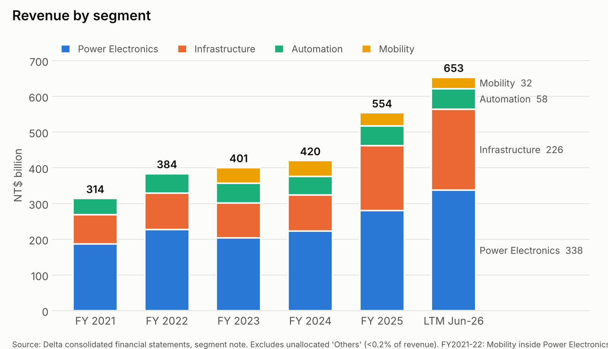
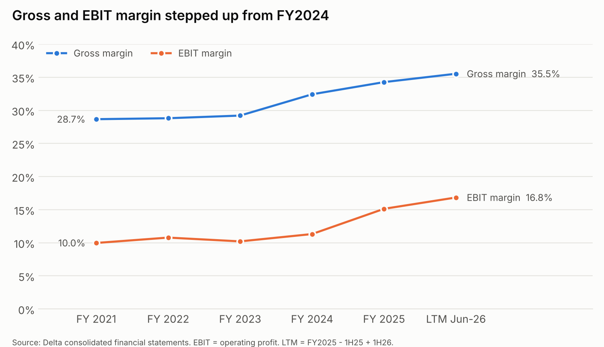
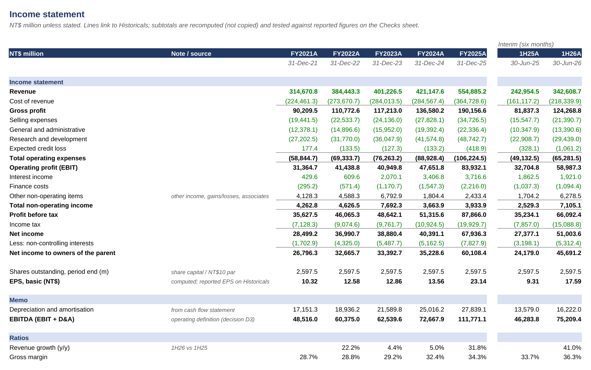
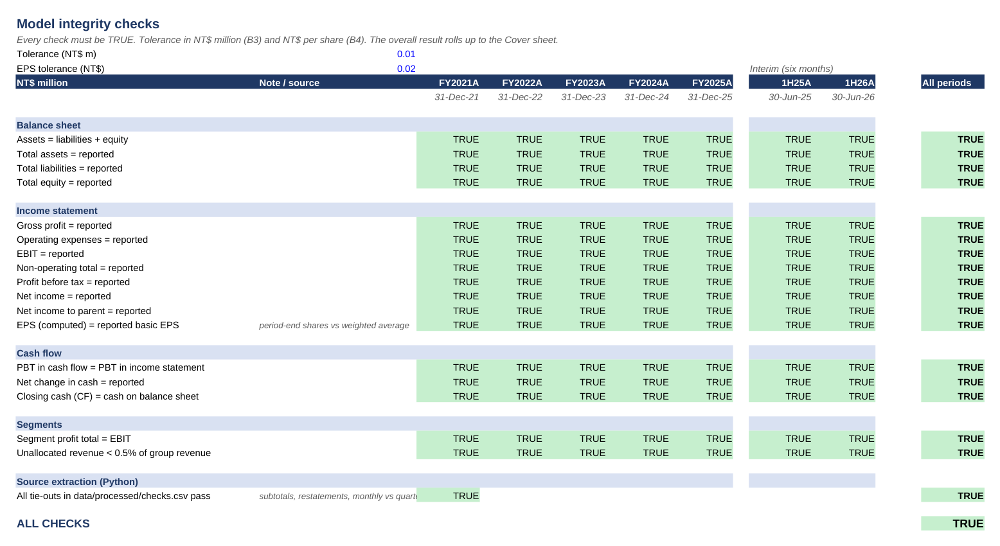
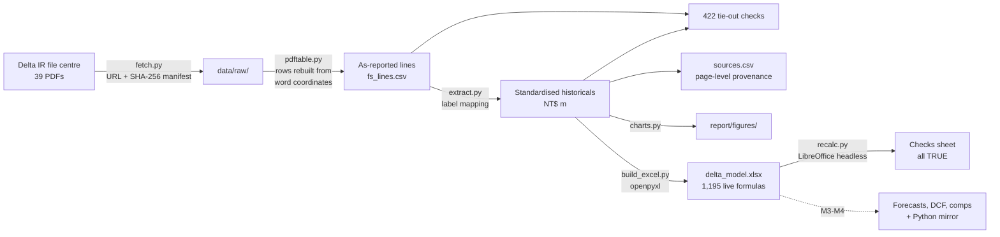

# Delta Electronics (2308.TW): The AI power play

**An equity research initiation on Delta Electronics, the Taiwan-listed maker of power and thermal-management products, built from primary filings: a reproducible data pipeline, a linked three-statement model, valuation and a 10–12 page report.**

[](https://github.com/anou-shka/delta-volts/actions/workflows/ci.yml)


By **Anoushka**: CS + Business (NTU), CFA Level II candidate.

> *Student research for educational purposes only. Not investment advice.*

---

## Why this project

Delta Electronics sells the power supplies, power distribution and liquid cooling that go inside AI server racks. Its revenue grew **32% in FY2025** and **41% in 1H26**. The question this initiation answers is: **how much of Delta is now an AI bet, and what is the market already paying for?**

The research is built to be audited:
- **Every number is traced to a page.** Historicals are extracted by code from Delta's audited and reviewed filings. Each figure is logged in [`data/sources.csv`](data/sources.csv) with document, page, URL and access date (920 entries).
- **Every extraction is proven, not assumed.** 422 automated tie-out checks cover subtotals, links between the three statements, cash, quarterly sums, segment totals against EBIT, monthly releases against quarters, and prior-year restatements. All pass, and CI reruns them on every push.
- **The model is live, not pasted.** [`model/delta_model.xlsx`](model/delta_model.xlsx) is generated by code with 1,195 working formulas. The statements recompute every subtotal from the extracted inputs, and 18 integrity checks, run for every period, must all be TRUE. CI rebuilds and recalculates it on every push.
- **The analyst's judgement is visible.** Modelling decisions are recorded with their reasoning in [`docs/decisions.md`](docs/decisions.md). Judgement calls in the report are marked `[ANALYST TO REVIEW]` until signed off.

## What the filings show so far

<picture>
  <source media="(prefers-color-scheme: dark)" srcset="report/figures/segment_revenue_dark.png">
  
</picture>

<picture>
  <source media="(prefers-color-scheme: dark)" srcset="report/figures/margins_dark.png">
  
</picture>

| NT$ bn unless stated | FY2021 | FY2022 | FY2023 | FY2024 | FY2025 | 1H26 |
|---|---:|---:|---:|---:|---:|---:|
| Revenue | 314.7 | 384.4 | 401.2 | 421.1 | 554.9 | 342.6 |
| Gross margin | 28.7% | 28.8% | 29.2% | 32.4% | 34.3% | 36.3% |
| EBIT margin | 10.0% | 10.8% | 10.2% | 11.3% | 15.1% | 17.2% |
| EPS, basic (NT$) | 10.32 | 12.58 | 12.86 | 13.56 | 23.14 | 17.59 |
| Cash from operations | 28.3 | 46.5 | 71.1 | 72.9 | 98.5 | 63.1 |
| Capex (PPE + intangibles) | 24.3 | 22.4 | 28.3 | 35.1 | 47.2 | 27.8 |

**Key findings so far:**
1. **Growth is concentrated in Infrastructure.** Infrastructure revenue rose **82% to NT$182.0bn in FY2025** and its segment profit went from NT$5.5bn to NT$28.4bn. This is the segment that holds data-centre power and liquid-cooling systems. Mobility (EV powertrain) shrank 16% and made a loss.
2. **AI is now a large, disclosed share of revenue.** According to Delta management:
   - data-centre business was **over half of 1H26 revenue**;
   - AI-related products will be **over 25% of FY2026 revenue**;
   - liquid cooling was **~10% of FY2025 revenue**.

   These figures, not press estimates, anchor the model's AI line ([decision D1](docs/decisions.md)).
3. **Margins have stepped up with the mix.** Gross margin rose from 28.7% (FY2021) to 36.3% (1H26). **1H26 EPS of NT$17.59 is up 89% y/y** and already above every full year before FY2025. Management calls ~35% gross margin "reasonable", so further expansion isn't assumed.
4. **The next test is capital intensity.** Management expects **~NT$70bn of capex in FY2026**, up from NT$47.2bn in FY2025, with new plants in Thailand, the US, China and Taiwan. From April 2026, new AI equipment is depreciated over **3 years**. The model must show whether returns hold as D&A catches up.
5. **The balance sheet is a net cash position.** At 30 Jun 2026: cash NT$182.4bn against borrowings and bonds of NT$70.6bn.
6. **Returns jumped and working capital is stable.** Return on equity rose from 16% (FY2024) to **24% (FY2025)**. Receivable and inventory days have held at roughly 80 and 100, while payable days rose to 95. The two weak segments are clear in the schedules: Automation's margin fell from 10.8% (FY2021) to 1.0% (FY2025) and turned negative in 1H26, and Mobility is loss-making.

**Rating, price target and reverse DCF:** to come in M4–M5. The base period will be updated to 9M26 when Delta publishes Q3 2026 results, expected around 29 Oct 2026 ([decision D2](docs/decisions.md)).

## Status

| Milestone | Deliverable | Status |
|---|---|---|
| **M1 Data** | Filings pipeline, historicals FY2021–1H26, sources, tie-out checks | ✅ Done |
| **M2 Historical model** | Excel: Cover, Assumptions, Historicals, Segments, IS/BS/CF, Schedules, Checks (all TRUE) | ✅ Done |
| M3 Forecasts | Segment and AI revenue build, Bear/Base/Bull, 5-year three-statement forecast | ⏳ Next |
| M4 Valuation | WACC, DCF, comps, sensitivities, football field, reverse DCF, Python mirror + test | ⏳ |
| M5 Report | 10–12 page initiation with charts | ⏳ |
| M6 Polish | PDF, case study, interview defence sheet | ⏳ |

## The model

[`model/delta_model.xlsx`](model/delta_model.xlsx) follows banking conventions: blue for inputs, black for formulas, green for links between sheets. Units are NT$ million throughout, with a unit note on every sheet.

| Sheet | What it does |
|---|---|
| **Cover** | Company, period, scenario, key historicals, and one cell that is TRUE only if every check passes |
| **Assumptions** | Scenario selector (Bear / Base / Bull) and each forecast driver's historical reference; forecast inputs arrive in M3 |
| **Historicals** | The only hard-coded financial data: extracted as-reported figures, FY2021A–FY2025A plus 1H25A and 1H26A |
| **Segments** | Revenue and profit for the four segments, growth, mix, margins, and the AI data-centre anchors from management disclosures |
| **IS / BS / CF** | The three statements, built entirely from formulas. "Other" lines tie each section to a separately reported subtotal, so *assets = liabilities + equity* is a real test |
| **Schedules** | Working-capital days, PP&E roll-forward, D&A, cost of debt, tax, dividends and payout, returns |
| **Checks** | 18 checks across 7 periods: the balance sheet balances, every subtotal equals the reported figure, CF closing cash equals BS cash, segment profit equals EBIT, and the Python tie-outs pass |

<p align="center"></p>

<p align="center"></p>

## How it works



- **Extraction.** Delta's PDFs don't keep text in reading order: a value can print one line below its label, and the brackets on negative numbers are separate glyphs. [`pdftable.py`](src/delta/pdftable.py) therefore rebuilds each row from word positions. Labels sit left of the notes column, and figures are assigned to columns by their right edge.
- **Standardisation.** Reported lines map to model lines with explicit patterns ([`extract.py`](src/delta/extract.py)). Residual lines are computed against reported totals, so the standardised balance sheet ties by construction.
- **Restatements.** Each year comes from its own audited report, and the next year's comparatives are checked against it (no statement restatements were found). Segments use the latest restated basis: Delta carved Mobility out of Power Electronics in 2024 and reclassified products again in 2025.
- **Definitions.** EBITDA = EBIT + D&A (Delta's slides add non-operating income). Capex is cash paid for PPE and intangibles. 2Q cash flows = 1H − 1Q.

## Run it

```bash
pip install -r requirements.txt
make all      # fetch filings (skips ones already in data/raw/) -> extract -> charts -> Excel model
make test     # tie-outs, plus: the workbook recalculates with zero errors and every check is TRUE
```

The raw PDFs are committed, so the pipeline runs offline from a fresh clone. `make fetch` re-downloads them from Delta's IR site. Building the model needs LibreOffice (`soffice`) to recalculate the formulas; the tests also check that the statement sheets contain no hard-coded numbers.

## Repository map

```
SPEC.md                    project brief and working rules
data/
  raw/                     original filings, untouched (+ manifest.csv)
  processed/               historicals, segments, monthly revenue, checks
  sources.csv              every sourced figure with page and URL
  sources_manual.csv       figures from transcripts and slides
src/delta/
  fetch.py                 download filings with provenance
  pdftable.py              position-based statement parser
  extract.py               standardise, check, write sources
  charts.py                figures (light + dark)
  build_excel.py           writes the Excel model with live formulas
  recalc.py                recalculates it in LibreOffice and scans for errors
  preview.py               renders model sheets to PNG
model/delta_model.xlsx     the model
report/figures/            charts and model previews
docs/
  decisions.md             analyst decision log
  milestone-notes.md       per-milestone summary, modelling choices, interview questions
  m1-review-sample.md      10 figures for manual verification
tests/                     extraction and Excel model tests
```

## Sources

Primary sources only, all from [Delta's investor relations site](https://www.deltaww.com/en-US/investors):
- consolidated financial statements FY2021–FY2025 (audited), Q1 and Q2 2026 (reviewed);
- annual reports 2024–2025;
- analyst meeting slides 4Q21–2Q26 and the 2Q26 meeting transcript;
- monthly revenue releases, Jan 2025 – Sep 2026.

Market data (yfinance), peer filings and Damodaran datasets come in M4. Full detail is in [`data/README.md`](data/README.md).

## Limitations

- **Delta doesn't report AI revenue as a line item.** The AI split rests on management's rounded statements (">25%", "~10%", ">50%"), so the AI line is an estimate with a range.
- **FY2021–FY2022 segment data is on the old 3-segment basis**, so Mobility history begins in FY2023.
- **Q3 2026 revenue is from unaudited monthly releases** until the Q3 report is published.
- **The 2Q26 transcript is an English translation.** Delta notes the Mandarin original prevails.
- **Public information only.** No non-public or company-internal information is used.

---

*Student research for educational purposes only. Not investment advice. Figures in NT$ (TWD) unless stated; Delta reports in NT$ thousands under Taiwan IFRS.*
