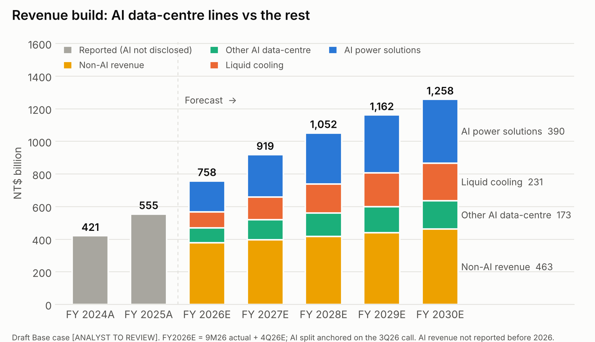
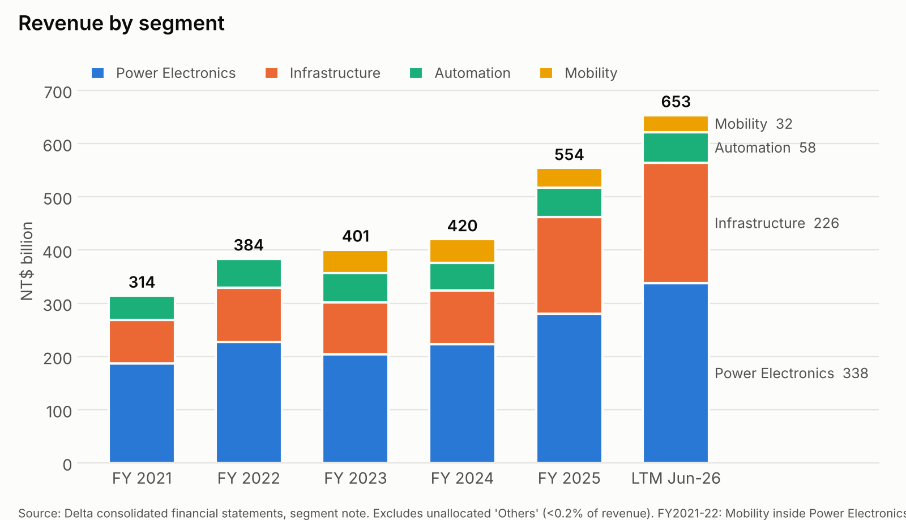
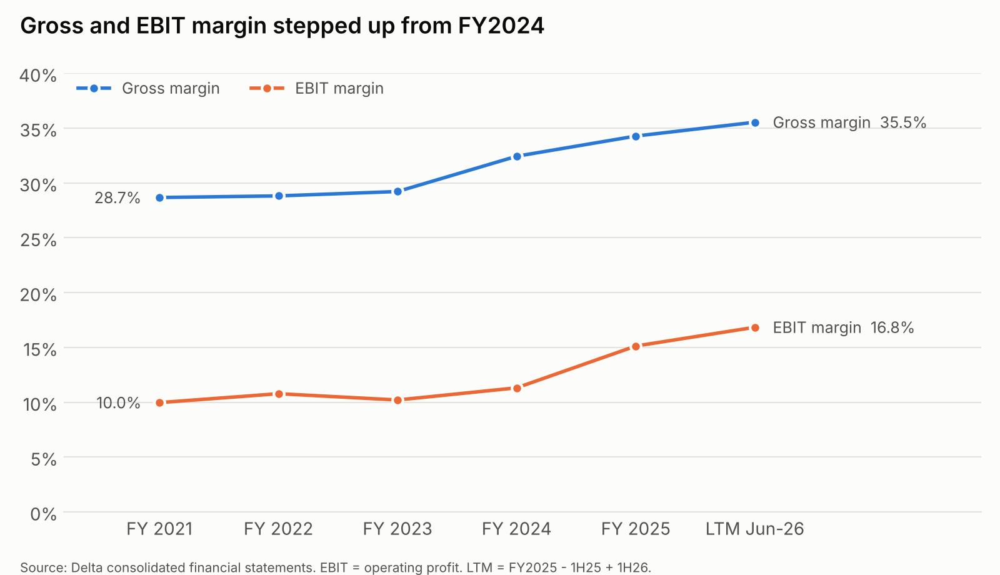
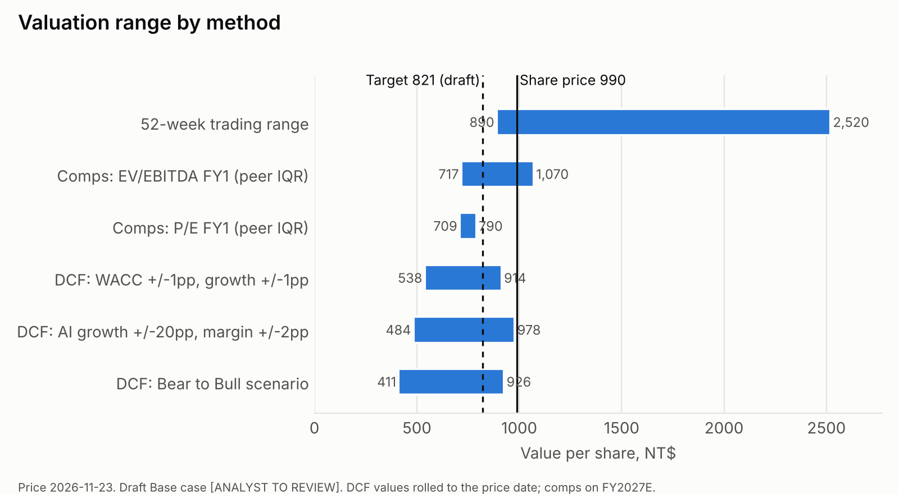
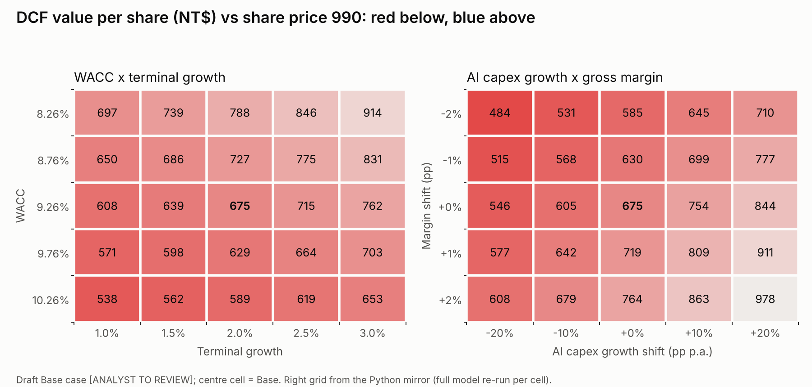

# Summary

| Rating | 12-month target | Price (2026-11-23) | Upside |
|---|---|---|---|
| **Sell** `[ANALYST TO REVIEW]` | **NT$821** | NT$990 | **-17%** |

*Draft. The rating follows the spec's rule (Buy above +15%, Sell below −10%) applied to a draft Base case that the analyst has not yet signed off.*

**Investment thesis** `[ANALYST TO REVIEW]` *(draft written from the model's evidence; the analyst writes the final version)*

1. **Half of Delta is now an AI data-centre business, and the earnings show it.** Management puts AI data-centre businesses at about 50% of revenue.[^q3call] Revenue rose 37% in 9M26 to NT$539.7bn, and EPS rose 62% to NT$26.64.[^ic3q]
2. **Even after halving, the price asks for more AI growth than our Base case.** At NT$990 the reverse DCF implies AI data-centre capex growth of about 48% a year in FY2027–30, against 14% in our Base case.
3. **Capital intensity is rising just as growth normalises.** Capex goes from NT$47.2bn in FY2025 to about NT$70bn in 2026.[^q2call] Depreciation lives for new AI equipment are shortening to three years, and Q3 gross margin fell to 34.1% on inventory write-downs.[^ic3q][^q3call]

| NT$ | FY2024A | FY2025A | FY2026E | FY2027E | FY2028E |
|---|---:|---:|---:|---:|---:|
| Revenue (NT$bn) | 421.1 | 554.9 | 757.7 | 918.5 | 1,051.9 |
| Revenue growth | 5.0% | 31.8% | 36.5% | 21.2% | 14.5% |
| EBIT margin | 11.3% | 15.1% | 16.9% | 17.4% | 17.7% |
| EPS (NT$) | 13.56 | 23.14 | 36.72 | 43.92 | 51.21 |
| P/E (x) | 73.0 | 42.8 | 27.0 | 22.5 | 19.3 |
| EV/EBITDA (x) | 34.6 | 22.3 | 15.3 | 11.9 | 9.9 |
| Dividend yield | 0.6% | 0.7% | 1.2% | 1.9% | 2.2% |

*FY2026E = 9M26 actual + 4Q26E. Multiples at NT$990; EV uses each year's net cash. Sources: Delta financial statements; model.*

{width=95%}

# Investment thesis `[ANALYST TO REVIEW]`

*Reasoning for the draft: the model's three strongest findings (AI share, the gap between price and Base case, capital intensity), each tied to a falsifiable indicator.*

**1. Delta has become an AI infrastructure company, and the numbers are audited, not promised.** Infrastructure revenue rose 82% in FY2025 to NT$182.0bn, and its operating profit rose from NT$5.5bn to NT$28.4bn.[^fs25seg] In 9M26 Power Electronics grew 44% and Infrastructure 47%.[^ic3q] On the 3Q26 call, the CFO put AI data-centre businesses at about 50% of revenue: AI power about 25% and liquid cooling NT$25bn in the quarter (about 13%).[^q3call] Group EBIT margin rose from 10.0% in FY2021 to 17.0% in 9M26.[^ic3q]
*What would prove it wrong:* AI data-centre revenue falling as a share of sales in the monthly releases, or Power Electronics and Infrastructure margins dropping below 15%.

**2. The share price still discounts more AI growth than our Base case.** The stock has fallen from about NT$1,965 in mid-October to NT$990.[^mkt] On our Base case (AI capex growth of 30% / 15% / 8% / 5% in FY2027–30) the DCF is worth NT$675 a share. To justify NT$990, AI capex would have to grow about 64% / 49% / 42% / 39% a year instead, and AI would reach 83% of FY2030 revenue. Consensus is also well above us: NT$60.4 FY2027 EPS against our 43.9.[^cons]
*What would prove it wrong:* hyperscaler capex guidance for 2027–28 above +40% a year, or Delta's FY2027 orders and monthly revenue tracking consensus rather than our Base case.

**3. Returns are at risk from capital intensity and margin slippage.** Capex rises to about NT$70bn in 2026 (9.2% of revenue) as Delta builds in Thailand, the US and Penang.[^q2call][^q3call] New AI equipment is depreciated over three years from April 2026.[^q2call] In 3Q26, inventory write-downs of about 1.7% of revenue pulled gross margin down to 34.1%.[^q3call] Our Base case still has free cash flow of NT$38.7bn in FY2026E rising to NT$159.3bn in FY2030E, so this is a returns question, not a solvency one: net cash was NT$81.1bn at end-FY2025.
*What would prove it wrong:* gross margin back above 35% in 4Q26–1Q27, as price increases take effect,[^q3call] and capex held to about 8% of revenue in 2027.

# Key debate: how durable is AI data-centre demand after 2027? `[ANALYST TO REVIEW]`

*Reasoning for the draft: it's the variable that moves value most (Sensitivity grid 2), and the sell-off shows the market is re-pricing it now.*

**The bull case.** Management says hyperscaler capex is US$700–800bn in 2026, heading above US$1tn in 2027, with global data-centre capex at US$1.2–1.5tn,[^q3call] and that investment stays robust through 2030. The IEA expects data-centre electricity use to more than double from 415 TWh in 2024 (about 1.5% of the world's electricity) to about 945 TWh in 2030.[^iea] Power density per rack keeps rising, which raises Delta's content per dollar of capex. A GB200 NVL72 rack draws about 120 kW,[^nvgb200] and NVIDIA's 800V DC architecture targets 1 MW racks from 2027.[^nv800] Delta starts mass production of ±400V and 800V HVDC products from 3Q26,[^q2call] and October revenue was a record NT$74.7bn, up 30%.[^mr10]

**The bear case.** Taiwan's AI complex sold off hard in November: the TAIEX fell about 25% from mid-October and 17.5% in one week (16–20 Nov), even after strong Nvidia results.[^news] Management itself lists four constraints that will make data-centre construction uneven: component shortages, power availability, a shortage of skilled electricians and local political opposition.[^q3call] Q3 showed the symptoms. Revenue was below expectations, gross margin fell to 34.1% on write-downs, and Infrastructure growth slowed to 25% y/y from 47% for the nine months.[^ic3q] If hyperscalers digest 2026–27 capacity, our Bear case (capex +15% in 2027, then −5%) cuts the DCF to NT$411.

**Where we stand (draft).** On our Base case the share price already assumes the bull case, so we lean cautious. The analyst decides.

# Company overview

Delta Electronics (Taipei) makes power and thermal-management products in four segments.[^fs25seg]
- **Power Electronics** (51% of FY2025 segment revenue): components, power supplies and systems, fans and thermal management.
- **Infrastructure** (33%): ICT infrastructure (data-centre power and cooling systems), energy infrastructure and displays.
- **Automation** (10%): industrial and building automation.
- **Mobility** (7%): EV powertrain systems.

No single customer exceeded 10% of revenue in FY2025.[^fs25geo] The AI business is still concentrated in the hyperscaler and GPU ecosystem, though: four business units serving AI make up about half of revenue.[^q3call]

| Segment (NT$bn) | FY2024 | FY2025 | 9M26 | FY2025 margin | 9M26 margin |
|---|---:|---:|---:|---:|---:|
| Power Electronics | 223.6 | 280.0 | 287.8 | 20.1% | 20.5% |
| Infrastructure | 100.2 | 182.0 | 180.2 | 15.6% | 18.6% |
| Automation | 52.4 | 54.9 | 45.8 | 1.0% | 0.9% |
| Mobility | 44.1 | 37.0 | 25.1 | -3.2% | -5.1% |

*FY2024 on the restated basis in the FY2025 report; 9M26 from the 3Q26 slides.[^fs25seg][^ic3q]*

**Geography: selling to the US, building in Asia.** The US has become Delta's largest single-country market: 36% of FY2025 revenue (NT$197.2bn), up from 23% in FY2021. Mainland China fell from 33% to 15%.[^fs25geo] Manufacturing assets sit elsewhere. Of NT$228.4bn of non-current assets, Thailand holds NT$71.0bn, Taiwan NT$62.5bn, China NT$33.9bn and the US only NT$7.3bn.[^fs25geo] Expansion is under way in Thailand (more plants due in 2026–27), the US, China and Taiwan,[^q2call] and in a new large site in Penang, Malaysia.[^q3call]

{width=88%}

# Industry: why AI racks need far more power and cooling

A single AI rack now draws power on a scale data centres weren't built for: NVIDIA's GB200 NVL72 rack draws about 120 kW and is liquid cooled.[^nvgb200] The next step is NVIDIA's 800V DC architecture, which targets 1 MW IT racks from 2027, developed with partners through the Open Compute Project.[^nv800] Each step up does three things for Delta:
- **More content.** More power conversion per rack: Delta supplies power shelves, including a 110 kW PSU for NVIDIA's Rubin platform, where it says it holds a leading position.[^q2call]
- **New architecture.** HVDC (±400V and 800V), solid-state transformers and fuel cells for on-site power. HVDC mass production starts in 3Q26, with meaningful volume in 2027.[^q2call]
- **Liquid cooling.** Racks at these densities are liquid cooled.[^nvgb200] Delta's liquid cooling reached NT$25bn of revenue in 3Q26, and management expects liquid-to-air cooling to stay in use longer than the market thinks.[^q3call][^q2call]

The constraint is the grid itself. The IEA estimates data centres used about 1.5% of global electricity in 2024, rising to just under 3% by 2030.[^iea] Management cites power availability and electrician shortages as the main brakes on construction.[^q3call]

**Where Delta sits in the chain.** Grid/energy infrastructure → data-centre power distribution (UPS, HVDC, SST) → rack power shelves and PSUs → cooling (CDUs, cold plates, fans). Delta's segments cover every step except the grid itself.[^fs25seg] Our peer set reflects that: Vertiv, Schneider Electric and Eaton in systems, Lite-On and AcBel in power supplies.

# Segment forecasts and scenarios

Our forecast starts from 9M26 actuals plus a 4Q26 estimate of NT$218.0bn (management guides Q4 above Q3's NT$197.1bn).[^q3call] Revenue is then built in two parts:
- **AI data-centre revenue**, anchored at 50% of FY2026E revenue (power 25%, liquid cooling 13%, other 12%),[^q3call] grows with AI data-centre capex times Delta's content and share gain.
- **The rest** grows with its own drivers: industrial demand for Automation, EV demand for Mobility.

EBIT is segment revenue × segment margin. All 40 drivers, with a rationale for each, are in `model/assumptions.csv`.

| NT$bn | FY2026E | FY2027E | FY2028E | FY2029E | FY2030E |
|---|---:|---:|---:|---:|---:|
| Revenue | 757.7 | 918.5 | 1,051.9 | 1,161.6 | 1,257.6 |
| of which AI data-centre | 378.8 | 521.1 | 634.6 | 722.3 | 795.1 |
| Power Electronics | 405.0 | 497.1 | 571.7 | 631.7 | 683.8 |
| Infrastructure | 253.0 | 316.5 | 369.2 | 411.4 | 447.4 |
| Automation | 63.4 | 68.5 | 72.6 | 76.9 | 81.5 |
| Mobility | 35.1 | 35.1 | 36.9 | 39.8 | 43.0 |
| EBIT | 127.7 | 160.0 | 186.3 | 207.9 | 225.7 |
| Net income to parent | 95.4 | 114.1 | 133.0 | 149.1 | 162.7 |
| Free cash flow (CFO + capex) | 38.7 | 79.0 | 114.1 | 138.9 | 159.3 |
| Capex | 70.0 | 82.7 | 84.2 | 81.3 | 81.7 |
| AI data-centre % of revenue | 50% | 57% | 60% | 62% | 63% |
| EBIT margin | 16.9% | 17.4% | 17.7% | 17.9% | 17.9% |
| EPS (NT$) | 36.72 | 43.92 | 51.21 | 57.39 | 62.63 |

*Draft Base case `[ANALYST TO REVIEW]`. NT$bn unless stated.*

| | Bear | Base | Bull |
|---|---:|---:|---:|
| AI data-centre capex growth FY27/28/29/30 | +15% / -5% / +0% / +3% | +30% / +15% / +8% / +5% | +40% / +25% / +15% / +10% |
| Content gain: AI power (FY2027E) | +0% | +5% | +10% |
| Content gain: liquid cooling (FY2027E) | +0% | +10% | +15% |
| Power Electronics margin FY2030E | 17.0% | 20.0% | 21.5% |
| Infrastructure margin FY2030E | 15.0% | 18.5% | 20.0% |
| Gross margin FY2030E | 33.0% | 35.0% | 36.0% |
| FY2030E revenue (NT$bn) | 779 | 1,258 | 1,758 |
| FY2030E AI data-centre % of revenue | 52% | 63% | 70% |
| FY2030E EPS (NT$) | 29.68 | 62.63 | 98.10 |
| DCF value per share today (NT$) | 411 | 675 | 926 |
| 12-month target (NT$) | 562 | 821 | 1,033 |

*Bear: hyperscaler digestion after 2027, no share gains, margins revert. Bull: capex keeps compounding, faster HVDC and liquid-cooling adoption.*

# Financials

{width=80%}

**Margins.** Gross margin rose from 28.7% (FY2021) to 34.3% (FY2025) and 35.5% (9M26). EBIT margin rose from 10.0% to 15.1% and 17.0%.[^fs25is][^ic3q] Management calls a gross margin of around 35% "reasonable".[^q2call] Our Base case holds 35.0%, with EBIT margin rising to 17.9% by FY2030E on mix.

**Cash flow and the capex cycle.** Operating cash flow was NT$98.5bn in FY2025, against capex of NT$47.2bn.[^fs25cf] Our Base case has FY2026E operating cash flow of NT$108.7bn, held back by an inventory build. Free cash flow is NT$38.7bn in FY2026E, rising to NT$159.3bn by FY2030E as capex falls back towards 6.5% of revenue.

**Balance sheet.** At end-FY2025 Delta held NT$151.2bn of cash against total debt of NT$74.0bn, and return on equity was about 24%.[^fs25bs] Dividends are paid the year after they're earned: NT$11.6 a share out of FY2025 earnings, about a 50% payout.[^ic4q25] Working capital is the swing factor. Receivable days were 80 and payable days 95 in FY2025, and management expects to carry larger inventory buffers.[^q3call]

# Valuation

**DCF.** WACC is 9.26%. That combines a cost of equity of 9.46% with a small amount of debt, about 3% of capital at market value:
- **Risk-free rate 2.03%:** Taiwan's 10-year government bond yield.[^tpex]
- **Equity risk premium 5.01%:** mature market 4.23% plus 0.78% for Taiwan.[^damo]
- **Levered beta 1.48:** from an industry unlevered beta of 1.45.[^damo] A regression on the TAIEX gives 1.73 (2-year raw) and 1.49 (Blume-adjusted).

Five years of free cash flow to the firm and a Gordon terminal value at 2.0% growth give an enterprise value of NT$1,753.9bn, of which the terminal value is 78%. Adding NT$82.5bn of net cash and investments, and deducting minorities at their 10.5% share of earnings, gives **NT$675 a share** today. The terminal value implies only 7.3× FY2030E EBITDA. Using a 12× exit multiple instead gives NT$1,010. **That gap is the largest judgement in this valuation** `[ANALYST TO REVIEW]`.

**Comps.** Peers trade at a median 13.4× FY1 EV/EBITDA and 16.8× FY1 P/E.[^cons] Applied to our FY2027E, these give NT$982 and NT$737: comps value NT$859.
- **Closest peers:** Vertiv and Schneider are the closest data-centre power plays.
- **Taiwan peers:** Lite-On and AcBel share Delta's power-supply market but are smaller and lower-margin.
- **Eaton** adds US electrical exposure.

| Company | EV (NT$bn) | EV/EBITDA TTM | EV/EBITDA FY1 | P/E TTM | P/E FY1 |
|---|---:|---:|---:|---:|---:|
| Delta Electronics | 2,473 | 16.5x | 10.9x | 29.8x | 16.4x |
| Vertiv | 2,095 | 20.0x | 13.4x | 31.1x | 16.8x |
| Schneider Electric | 5,409 | 17.5x | 14.6x | 27.2x | 18.0x |
| Eaton | 4,643 | 20.0x | 16.9x | 31.1x | 18.9x |
| Lite-On Technology | 395 | 13.5x | 9.3x | 19.1x | 12.1x |
| AcBel Polytech | 31 | 13.0x | 9.7x | 26.1x | 16.1x |
| **Peer median (excl. Delta)** | | 17.5x | 13.4x | 27.2x | 16.8x |

{width=92%}

**Price target and rating** `[ANALYST TO REVIEW]`. A 50/50 blend of DCF and comps (NT$767 today), rolled forward 12 months at the cost of equity and less the expected FY2027 dividend, gives a target of **NT$821**: -17% against NT$990, or **Sell** under the spec's rule. Bear / Base / Bull targets are NT$562 / NT$821 / NT$1,033, against a 52-week range of NT$890–NT$2,520.

**Reverse DCF.** We solved for the uniform increase in AI data-centre capex growth that makes the DCF equal the share price. The answer is **+34 percentage points a year**, taking growth from 30% / 15% / 8% / 5% to 64% / 49% / 42% / 39% in FY2027–30. At that rate AI data-centre revenue would be 83% of FY2030 revenue and EPS NT$140. Alternatively, the market is paying for growth well beyond 2030, which a 12× exit multiple captures.

{width=95%}

# Risks

| Risk | Why it matters | Indicator to watch |
|---|---|---|
| **AI capex slowdown** | About half of revenue is tied to AI data-centre spending;[^q3call] the Bear case cuts value to NT$411 | Hyperscaler capex guidance; Delta monthly revenue y/y |
| **Customer concentration** | No customer is above 10% of revenue,[^fs25geo] but AI demand flows through a few hyperscalers and one GPU ecosystem | Revenue mix by segment; NVIDIA platform transitions (Rubin, 800V) |
| **Tariffs and US–China/Taiwan geopolitics** | The US is 36% of revenue but holds NT$7.3bn of non-current assets; production is in Thailand, Taiwan and China[^fs25geo] | US tariff rulings on Thai/Taiwanese electronics; Delta's US capacity build |
| **Margin pressure from competition and costs** | Q3 gross margin fell to 34.1% on write-downs; raw materials are up about 2% this year[^q3call] | Gross margin vs 35%; price increases landing in 4Q26–1Q27 |
| **Execution on capacity expansion** | Capex of about NT$70bn in 2026; new plants in Thailand, the US and Penang[^q2call][^q3call] | Capex vs guidance; inventory days; plant start dates |
| **FX** | 88% of FY2025 revenue came from outside Taiwan,[^fs25geo] while results are reported in NT$; USD/TWD was 32.92 on the price date[^mkt] | USD/TWD; non-operating FX gains/losses |
| **Litigation** | Vicor's patent case and ITC investigation involve several power-supply makers[^q3call] | ITC rulings |

# Appendix

**A. Model and sources.** Full statements FY2021A–FY2030E, schedules, DCF, comps and checks are in `model/delta_model.xlsx`, generated from code with live formulas. Every input is in `model/assumptions.csv` and `model/valuation_inputs.csv`, and every sourced figure, with page and URL, is in `data/sources.csv`. The Python mirror (`src/delta/model.py`) agrees with the workbook within 0.1% in all scenarios.

**B. Basis of preparation.**
- **Historicals:** audited FY2021–FY2025 and reviewed 1H26 statements (Taiwan IFRS, NT$ thousands, shown in NT$bn).
- **Q3 2026:** from the 3Q26 earnings slides and transcript; the English Q3 statements weren't yet published.
- **Market data:** 2026-11-23, Yahoo Finance via yfinance.

*Student research for educational purposes only. Not investment advice.*

[^fs25is]: Delta Electronics, consolidated financial statements FY2021–FY2025 (audited), statements of comprehensive income.
[^fs25bs]: Delta Electronics, FY2025 consolidated financial statements, balance sheet p.8–9.
[^fs25cf]: Delta Electronics, FY2025 consolidated financial statements, cash flow statement p.14–15.
[^fs25seg]: Delta Electronics, FY2025 consolidated financial statements, Note 14 (operating segments) p.111; FY2024 restated.
[^fs25geo]: Delta Electronics, FY2025 consolidated financial statements, Note 14(6)–(7) (geography; major customers) p.112.
[^ic3q]: Delta Electronics, 3Q26 results presentation (29 Oct 2026), p.4–6, 12–18.
[^ic4q25]: Delta Electronics, 4Q25 results presentation (26 Feb 2026), p.19.
[^q2call]: Delta Electronics, 2Q26 results meeting transcript (30 Jul 2026), p.2–13.
[^q3call]: Delta Electronics, 3Q26 earnings conference transcript (29 Oct 2026), p.1–7.
[^mr10]: Delta Electronics, monthly revenue release, October 2026 (9 Nov 2026).
[^mkt]: Yahoo Finance via yfinance, snapshot 2026-11-23 (`data/raw/market/`).
[^cons]: Yahoo Finance analyst consensus averages, snapshot 2026-11-23.
[^tpex]: Taipei Exchange (TPEx), Newsletter November 2026, bond market review: 10-year yield 2.0300% at 31 Oct 2026.
[^damo]: A. Damodaran, country risk premiums and industry betas (emerging markets), updated 5 Jan 2026.
[^iea]: IEA, *Energy and AI* (2025): data centres 415 TWh in 2024 (~1.5% of global electricity), ~945 TWh in 2030.
[^nvgb200]: NVIDIA, DGX GB200 user guide (hardware): rack power ~120 kW.
[^nv800]: NVIDIA developer blog, "NVIDIA 800 V HVDC architecture will power the next generation of AI factories".
[^news]: Focus Taiwan (3 Nov 2026) and Yahoo Finance (Nov 2026) market reports on the TAIEX sell-off.
